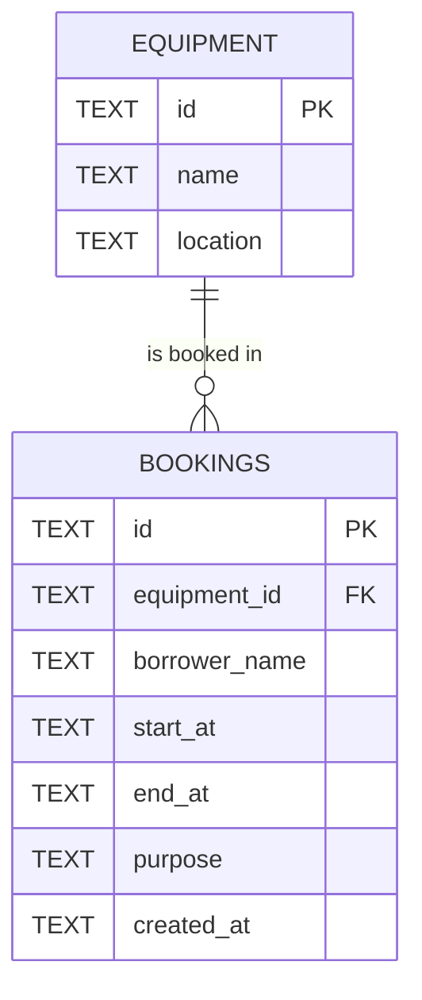

# Campus Equipment Booking API (Hono + TypeScript + D1/SQLite)

Individual midterm lab: REST API for booking shared equipment without overlapping times.

**Base API URL used for testing:** `http://localhost:8787/api`

## Prerequisites
- Node.js 18+ and npm
- Windows users: use **Git Bash** or **cmd** (PowerShell 5.1 does not support `&&`, and may block `npm` until you run
  `Set-ExecutionPolicy -Scope CurrentUser -ExecutionPolicy RemoteSigned`). In PowerShell, call `curl.exe`, not `curl`.

## Run
```bash
npm install
npm run db:init      # creates tables and seeds eq-1, eq-2, eq-3 in the local D1 database
npm run dev          # serves http://localhost:8787  (BASE_URL = http://localhost:8787/api)
```
`npm run db:init` drops and recreates the tables, so it also resets all data.

## Test
With the server running, open a second terminal:
```bash
npm run test:curl              # automated curl suite: prints PASS/FAIL, status and response body per case
npm run test:curl > TEST_EVIDENCE.txt
npm run typecheck
```
Manual commands from the instructor's `curl_test_guide.md` also work against this API (steps 1–9, including the full-payload PATCH in step 5).
Run `npm run db:init` before a fresh run if earlier manual tests left bookings behind.

## Documentation
- [`API_CONTRACT.md`](API_CONTRACT.md) – endpoints, payloads, status codes, validation rules, assumptions
- [`AI_LOG.md`](AI_LOG.md) – AI prompts, what was used, how it was verified
- [`QUALITY_GATE_REVIEW.md`](QUALITY_GATE_REVIEW.md) – findings → action → evidence
- `TEST_EVIDENCE.txt` – saved output of the curl suite

## Project structure
- `src/index.ts` – routes, validation, error handler
- `schema.sql` – tables, constraints, index, seed data
- `test.sh` – curl test suite

## Schema / ERD

One equipment has many bookings; each booking belongs to exactly one equipment.
`CHECK (start_at < end_at)` is enforced in the database; an index on `(equipment_id, start_at, end_at)` supports overlap lookups.

## Key design decisions
- **Overlap rule (create and update):** `existing.start < new.end AND existing.end > new.start`, same equipment only. Back-to-back bookings are allowed. Update excludes the booking itself (`id != ?`).
- **Atomic check-and-write:** one `INSERT … WHERE NOT EXISTS` / `UPDATE … AND NOT EXISTS` statement, so concurrent requests cannot both pass the check.
- **Status codes:** `400` invalid/missing data (including unknown `equipmentId` in the body), `404` booking in the URL not found, `409` time conflict.
- **PATCH:** merges the stored booking with the supplied fields, then validates the whole result.

## Security
- All SQL uses `prepare().bind()`; no request data is concatenated into SQL.
- Strict validation, 10 KB body limit, generic 500 message (details only in server log).
- CORS is not enabled: testing is done with curl, and a browser client is optional in the brief.

## Test summary
| # | Case | Expected | Result |
|---|---|---:|---|
| 1 | Create booking | 201 | (fill from your run) |
| 2 | Get / list bookings | 200 | |
| 3 | Update booking | 200 | |
| 4 | Delete booking | 204 | |
| 5 | Invalid time range | 400 | |
| 6 | Unknown `equipmentId` | 400 | |
| 7 | Booking not found | 404 | |
| 8 | Overlap on create | 409 | |
| 9 | Overlap on update | 409 | |

## Limitations
No authentication or pagination (not required by the brief); `purpose` is optional by assumption.